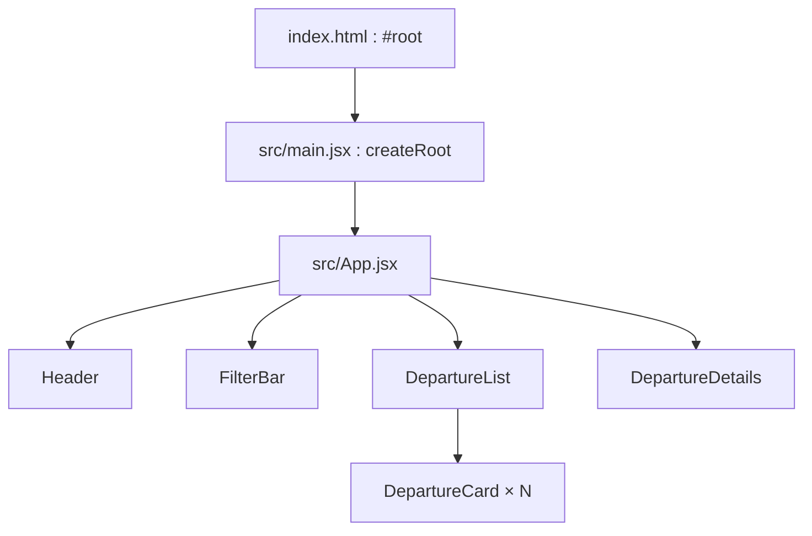

# 01 — Projet et architecture

## Du fichier HTML à l’écran React

[`index.html`](../index.html) contient un élément `

` et charge [`src/main.jsx`](../src/main.jsx). `main.jsx` appelle `createRoot(...).render(<App />)`. Le navigateur obtient donc une page HTML minimale ; React construit l’interface dans l’élément `root`. [`src/App.jsx`](../src/App.jsx) est le point de départ de l’arbre de composants. [`src/style.css`](../src/style.css) ne contient que l’apparence : les décisions de filtre et de statut sont dans le JavaScript.

Vite sert les fichiers pendant le développement avec `npm run dev`, puis transforme et rassemble le code pour la production avec `npm run build`. `npm run preview` sert le résultat compilé. Le script `dev` ne contient aucune logique de départ de bus. Le fichier [`package.json`](../package.json) déclare React, React DOM et Vite. Cette version du projet emploie le traitement JSX intégré à Vite ; les fichiers `.jsx` importent donc `React` pour le runtime JSX classique.

## Responsabilités des fichiers

| Fichier | Responsabilité | Ce qu’il reçoit ou conserve |
| --- | --- | --- |
| [`data/departures.js`](../src/data/departures.js) | Fournir les quatre valeurs initiales | Aucun state ; c’est la fixture de départ |
| [`App.jsx`](../src/App.jsx) | Posséder les trois states, calculer les vues et relier les callbacks | `departures`, `filter`, `selectedId` |
| [`Header.jsx`](../src/components/Header.jsx) | Afficher le titre et le total global | `total` |
| [`FilterBar.jsx`](../src/components/FilterBar.jsx) | Afficher les trois choix et signaler un clic | `filter`, `onChange` |
| [`DepartureList.jsx`](../src/components/DepartureList.jsx) | Afficher une liste ou son état vide | `departures`, `selectedId`, `onSelect` |
| [`DepartureCard.jsx`](../src/components/DepartureCard.jsx) | Afficher un départ et son bouton | `departure`, `selected`, `onSelect` |
| [`DepartureDetails.jsx`](../src/components/DepartureDetails.jsx) | Afficher le détail ou un message, demander un changement | `selectedDeparture`, `selectionHidden`, `onToggleStatus` |

Le nom `departures` dans `DepartureList` désigne la **liste déjà filtrée** que lui donne `App`. Ce composant ne connaît pas le filtre. Le même composant pourrait donc afficher n’importe quel sous-ensemble de départs.

## Pourquoi les données initiales ne sont pas l’état courant

`initialDepartures` est importé une fois comme valeur initiale de `useState`. Après un clic sur « Signaler un retard », `departures` dans `App` devient un **nouveau tableau**. Si un composant relisait `initialDepartures` directement, il montrerait les anciens statuts et contredirait le reste de l’écran. Le module de données sert à démarrer et à retrouver l’état initial après rechargement, pas à représenter l’état actuel.

## Périmètre

Le changement de statut est une simulation locale. Il n’y a ni API, ni stockage, ni `useEffect`, ni routing, ni gestionnaire d’état externe. Un rechargement de page recrée l’application avec les quatre objets de départ. Cette limite rend le flux React observable sans ajouter des problèmes de réseau ou de synchronisation avec un backend.
