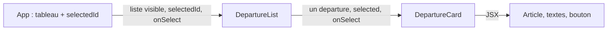

# 02 — Composants, JSX et props

## Un composant est une fonction de rendu

[`DepartureCard`](../src/components/DepartureCard.jsx) est une fonction JavaScript. React l’appelle pendant le rendu avec un objet de props et utilise le JSX retourné pour décrire les éléments à afficher. La fonction ne crée pas une carte figée : elle décrit **comment afficher une carte** pour les données qu’on lui donne. Dans ce projet, la même fonction sert à quatre départs différents.

```jsx
<DepartureCard
  departure={departure}
  selected={selectedId === departure.id}
  onSelect={onSelect}
/>
```

`departure` contient les données, `selected` est un booléen calculé par le parent, et `onSelect` est une fonction. L’enfant n’a besoin ni du tableau entier ni de connaître le state de `App`. Il lui suffit du contrat de props ci-dessus.



## Lire le JSX

JSX ressemble à du HTML, mais ses accolades insèrent des **expressions JavaScript**. Dans `<h3>{departure.destination}</h3>`, l’expression lit la destination du départ courant. Dans `selected={selectedId === departure.id}`, l’expression compare deux identifiants et produit `true` ou `false`. Le texte entre deux balises reste du texte normal.

Le composant choisit aussi ses classes avec une expression :

```jsx
className={`departure-card${selected ? ' departure-card--selected' : ''}`}
```

Quand `selected` vaut `true`, une seconde classe est ajoutée. Le CSS dessine alors la bordure de sélection ; le texte du bouton devient aussi « Sélectionné · retirer ». La couleur n’est donc pas le seul indice de l’état, et le bouton indique qu’un second clic désélectionne la carte.

Quelques règles utiles ici : `className` remplace l’attribut HTML `class` ; un composant personnalisé commence par une majuscule (`<Header />`) ; les éléments HTML natifs restent en minuscules (`<article>`). Chaque composant retourne un seul arbre JSX racine, éventuellement avec des éléments imbriqués.

## Props : lecture descendante

Une prop est une valeur fournie par le parent au rendu courant. `Header` reçoit `total`, puis affiche ce nombre. `FilterBar` reçoit `filter`, puis détermine quel bouton possède `aria-pressed="true"`. `DepartureCard` reçoit un objet `departure` et lit ses champs. Aucun de ces composants ne modifie les props reçues.

Cette règle donne une direction simple au flux des données :

```text
App possède les données → parent passe les props → enfant affiche les props
```

Si une carte modifiait directement `departure.status`, React ne serait pas averti d’un changement de state et plusieurs parties de l’écran pourraient diverger. La modification doit être demandée au parent qui détient le state ; c’est le sujet des chapitres [04](04-state-evenements-immutabilite.md) et [05](05-lifting-state-donnees-derivees.md).

## Exemple concret

Le deuxième objet a `id: 'DEP-102'`, `destination: 'Marrakech'` et `time: '09:10'`. Quand la liste passe cet objet à `DepartureCard`, les expressions JSX lisent ces champs et produisent « Marrakech » et « Départ prévu : 09:10 ». Aucun composant spécial pour Marrakech n’est nécessaire.
