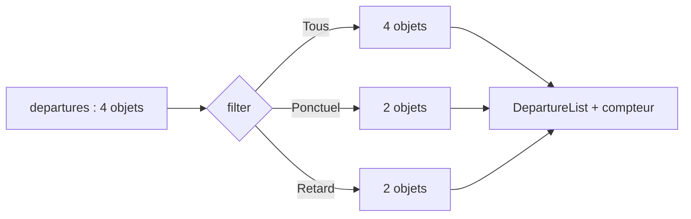

# 03 — Listes, clés et filtres

## D’un tableau à quatre cartes

[`initialDepartures`](../src/data/departures.js) est un tableau de quatre objets. [`DepartureList`](../src/components/DepartureList.jsx) utilise `map` pour convertir chaque objet en un élément `<li>` contenant une carte :

```jsx
<ul>
  {departures.map(departure => <li key={departure.id}>
    <DepartureCard departure={departure} selected={selectedId === departure.id} onSelect={onSelect} />
  </li>)}
</ul>
```

`map` ne change pas le tableau source. Il crée un nouveau tableau de descriptions JSX. React utilise ensuite ces descriptions pour afficher la liste. Si `departures.length === 0`, le composant retourne « Aucun départ dans cette vue. » : on évite une zone vide ambiguë.

## Pourquoi la clé est sur `li`

La clé donne à chaque élément de liste une identité stable entre deux rendus. React peut ainsi rapprocher l’ancien élément `DEP-102` du nouvel élément `DEP-102` quand le filtre change ou quand un statut fait sortir une carte de la liste. La clé doit être sur l’élément créé **directement** par `map`, donc ici sur `<li>`.

```text
Avant filtre : [DEP-101, DEP-102, DEP-103, DEP-104]
Après filtre : [DEP-101, DEP-102]
Clés gardées :  DEP-101  DEP-102
```

L’index du tableau serait une mauvaise identité : après un filtrage, l’index `0` pourrait désigner un autre départ. L’identifiant `DEP-102` continue, lui, à désigner le même objet logique. La clé est utilisée par React ; elle n’est pas une prop automatiquement reçue par `DepartureCard`. Le composant reçoit explicitement `departure.id` à l’intérieur de `departure`.

## Le filtre est une valeur, la liste est un calcul

Dans [`FilterBar`](../src/components/FilterBar.jsx), les libellés visibles et les valeurs internes sont distincts :

| Libellé du bouton | Valeur transmise à `App` |
| --- | --- |
| Tous | `Tous` |
| Ponctuels | `Ponctuel` |
| En retard | `Retard` |

Cette correspondance est importante : `departure.status` vaut `Ponctuel` ou `Retard`, au singulier. Le clic appelle `onChange(option.value)`, qui est `setFilter` passé par `App`. `aria-pressed={filter === option.value}` annonce quel bouton est actif, même sans voir sa couleur.

`App` calcule la vue depuis les données courantes :

```jsx
const visibleDepartures = filter === 'Tous'
  ? departures
  : departures.filter(departure => departure.status === filter);
```

`Array.prototype.filter` produit un nouveau tableau contenant les objets qui satisfont la condition ; il ne modifie pas `departures`. Au départ, les trois choix montrent respectivement 4, 2 et 2 cartes. Le compteur utilise `visibleDepartures.length`, tandis que `Header` utilise `departures.length` pour le total global. Ces deux nombres n’ont pas la même signification.



La liste filtrée n’est pas stockée avec `useState`. Si elle l’était, il faudrait la mettre à jour à chaque changement de `departures` **et** de `filter`, avec un risque de valeurs incohérentes. Le calcul pendant le rendu garantit qu’elle reflète toujours les deux sources actuelles.
