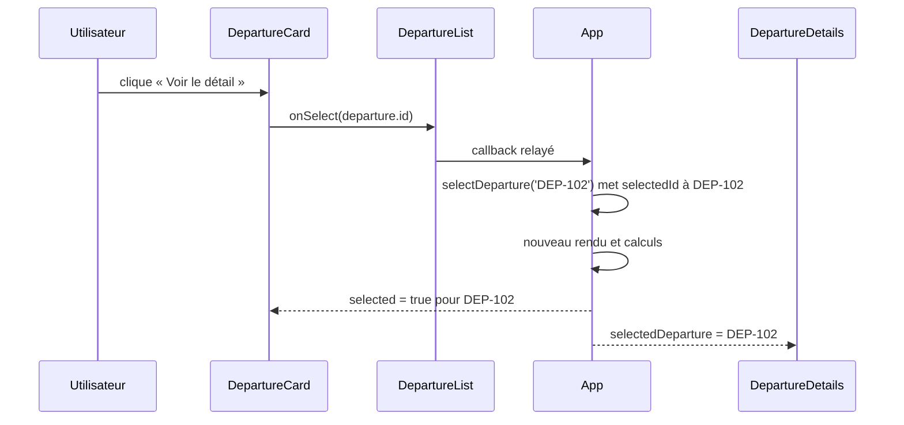

# 04 — State, événements et immutabilité

## Ce que `useState` conserve

Une variable locale ordinaire est recalculée quand React rappelle une fonction composant. `useState` conserve une valeur d’un rendu au suivant et donne une fonction pour demander sa mise à jour. Dans [`App`](../src/App.jsx), les trois states sont :

```jsx
const [departures, setDepartures] = useState(initialDepartures);
const [filter, setFilter] = useState('Tous');
const [selectedId, setSelectedId] = useState(null);
```

Au premier rendu, `departures` contient les quatre objets initiaux, `filter` vaut `Tous`, et `selectedId` vaut `null`. Appeler un setter demande à React un nouveau rendu avec la nouvelle valeur. La fonction `App` est réexécutée ; les valeurs dérivées sont recalculées ; React met à jour ce qui est affiché.

Le state n’est pas une variable que l’on modifie directement. Affecter `filter = 'Retard'` ou faire `departures[1].status = 'Retard'` ne suit pas le mécanisme de mise à jour React. On appelle le setter correspondant.

## Un clic est une intention remontée

Le bouton de [`DepartureCard`](../src/components/DepartureCard.jsx) a cet événement :

```jsx
onClick={() => onSelect(departure.id)}
```

La fonction fléchée est donnée à `onClick` pour être appelée **au clic**. Écrire `onClick={onSelect(departure.id)}` appellerait `onSelect` pendant le rendu et donnerait son résultat à `onClick`. Dans ce projet, `onSelect` est la fonction `setSelectedId` que `App` a passée à `DepartureList`, qui l’a relayée à la carte.



Le callback peut traverser un composant intermédiaire sans que celui-ci possède le state. `DepartureList` transmet l’intention ; `App` décide du changement. Dans l’application actuelle, `onSelect` appelle `selectDeparture(id)` : son setter fonctionnel renvoie `null` si `id` est déjà sélectionné, et `id` sinon. Un second clic sur le même bouton désélectionne donc le départ et le panneau revient à « Sélectionnez un départ ».

## Changer le statut sans modifier l’ancien tableau

Le bouton du détail appelle `onToggleStatus(selectedDeparture.id)`. Dans `App`, `toggleStatus` utilise la forme fonctionnelle du setter :

```jsx
setDepartures(current => current.map(departure =>
  departure.id === id
    ? { ...departure, status: departure.status === 'Ponctuel' ? 'Retard' : 'Ponctuel' }
    : departure,
));
```

`current` est la version courante du tableau au moment où React traite la mise à jour. `map` crée un **nouveau tableau**. Pour l’identifiant visé, `{ ...departure, status: ... }` crée un **nouvel objet** avec tous les anciens champs et un nouveau statut. Les trois autres objets sont conservés. Cette mise à jour est immuable : l’ancien tableau et l’ancien objet ciblé ne sont pas modifiés.

```text
Avant : [DEP-101, DEP-102 Ponctuel, DEP-103, DEP-104]
                         │ clic « Signaler un retard »
Après : [DEP-101, DEP-102 Retard,   DEP-103, DEP-104]
         nouveau tableau + nouvel objet DEP-102
```

La forme `current => ...` est utile quand la nouvelle valeur dépend de la précédente. Si plusieurs mises à jour sont demandées de près, chaque calcul reçoit la version courante au moment de son traitement. Le changement inverse utilise la même fonction : `Retard` redevient `Ponctuel`.

## Pourquoi le navigateur réagit

Après `setDepartures`, React rappelle `App`. Le filtre relit le nouveau statut, la liste visible peut changer, le compteur prend la nouvelle longueur et le détail est retrouvé à partir du nouveau tableau. Il n’est pas nécessaire de modifier directement le DOM, ni de maintenir quatre copies du statut.
