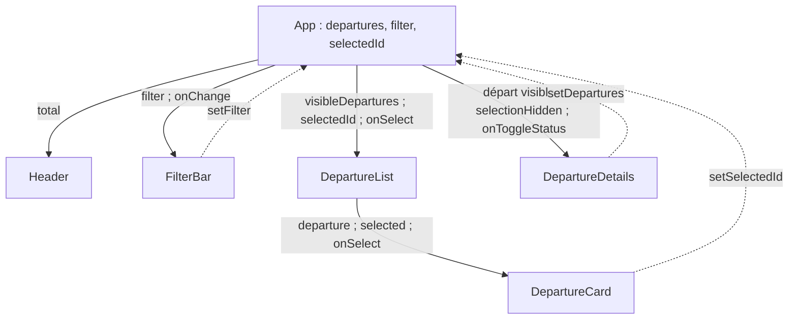

# 05 — Lifting state et données dérivées

## Choisir le propriétaire d’un state

Une sélection sert à la fois à la carte, qui affiche « Sélectionné », et au panneau de détail, qui affiche le départ choisi. Leur plus proche parent commun est [`App`](../src/App.jsx). `selectedId` vit donc dans `App`, puis descend vers les deux branches par des props. C’est le **lifting state** : placer l’état partagé au parent commun et faire remonter les intentions de changement par callback.

Le même raisonnement vaut pour `departures`. Un statut modifié doit affecter la carte, le filtre, le compteur et le détail. Si le statut était conservé seulement dans `DepartureDetails`, les autres branches n’auraient pas une source commune fiable.



Les flèches pleines représentent des valeurs descendantes ; les flèches pointillées représentent des callbacks appelés après une action. Un enfant n’écrit pas directement dans le state du parent.

## Trois states, plusieurs valeurs dérivées

`App` conserve uniquement `departures`, `filter` et `selectedId`. À chaque rendu, il calcule :

```jsx
const visibleDepartures = filter === 'Tous'
  ? departures
  : departures.filter(departure => departure.status === filter);
const selectedDeparture = departures.find(departure => departure.id === selectedId);
const selectedVisibleDeparture = visibleDepartures.find(
  departure => departure.id === selectedId,
);
const selectionHidden = Boolean(selectedDeparture) && !selectedVisibleDeparture;
```

`find` renvoie l’objet trouvé ou `undefined`. `selectedDeparture` cherche dans le tableau **complet** : il répond « quel départ est sélectionné ? ». `selectedVisibleDeparture` cherche dans la liste **filtrée** : il répond « ce départ est-il visible maintenant ? ». Les deux questions sont différentes.

Le booléen `selectionHidden` exige qu’une vraie sélection existe et qu’elle soit absente de la vue. Sans le test `Boolean(selectedDeparture)`, le chargement initial pourrait être pris à tort pour une sélection masquée. Aucune de ces quatre valeurs n’a besoin de son propre `useState` : elles sont déterminées entièrement par les trois sources.

## Le cas `DEP-102` sous « Ponctuels »

| Moment | `filter` | Statut de `DEP-102` | `selectedId` | Cartes visibles | Panneau |
| --- | --- | --- | --- | --- | --- |
| Chargement | Tous | Ponctuel | `null` | 4 | « Sélectionnez un départ » |
| Filtre activé | Ponctuel | Ponctuel | `null` | 2 | « Sélectionnez un départ » |
| Carte choisie | Ponctuel | Ponctuel | DEP-102 | 2 | Détail DEP-102 |
| Statut basculé | Ponctuel | Retard | DEP-102 | 1 | « La sélection est masquée par le filtre » |
| Retour à Tous | Tous | Retard | DEP-102 | 4 | Détail DEP-102 sélectionné |

À l’étape « Statut basculé », `selectedId` n’est pas effacé. La sélection existe encore dans `departures`, mais n’est plus dans `visibleDepartures`. Le panneau reçoit alors `selectionHidden=true` et n’affiche pas un détail qui semblerait appartenir à la liste ponctuelle. Le retour à « Tous » la rend visible sans demander un nouveau clic.

Quand une carte visible est déjà sélectionnée, cliquer à nouveau son bouton « Sélectionné · retirer » remet `selectedId` à `null`. Le détail affiche alors l’invitation à choisir un départ. Le filtre et les statuts ne changent pas.

## Invariant de cohérence

À chaque rendu, la liste, le compteur, les libellés de cartes et le détail lisent la même version de `departures`. Le compteur affiché vaut toujours `visibleDepartures.length`. Le total global vaut toujours `departures.length`, soit 4 dans ce projet. Cette cohérence découle du propriétaire unique de l’état et des calculs dérivés, pas d’une synchronisation manuelle après chaque clic.
