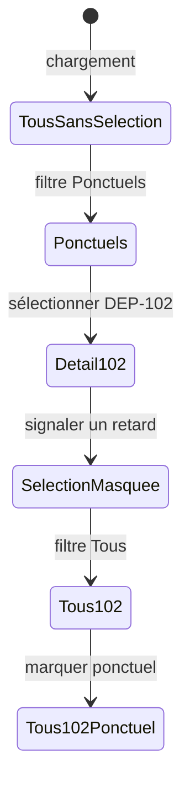

# 06 — Scénarios et diagnostic

## Démarrer et observer

Depuis la racine du projet, exécuter `npm install`, puis `npm run dev`, et ouvrir l’URL locale affichée. `npm run build` vérifie la transformation du projet pour la production. Le rechargement de la page restaure les données initiales : les modifications sont locales et non persistées.

Un premier contrôle visuel doit montrer quatre départs, dont `DEP-101` et `DEP-102` ponctuels, `DEP-103` et `DEP-104` en retard. Le compteur doit afficher « 4 départs affichés » et le panneau « Sélectionnez un départ ».

## Parcours guidé

1. Cliquer « Ponctuels » : `aria-pressed` devient vrai pour ce bouton, la liste montre deux cartes et le compteur vaut 2.
2. Cliquer « Voir le détail » sur `DEP-102` : cette carte indique « Sélectionné » et le panneau affiche Marrakech, L24, 09:10, Ponctuel.
3. Cliquer « Signaler un retard » : `DEP-102` quitte la vue, le compteur vaut 1 et le panneau annonce que la sélection est masquée.
4. Cliquer « Tous » : quatre cartes reviennent ; `DEP-102` est encore sélectionné, avec le statut Retard.
5. Cliquer « Marquer ponctuel » dans le détail : son statut redevient Ponctuel. Le filtre « En retard » montre maintenant seulement `DEP-103` et `DEP-104`.
6. Revenir à « Tous », puis cliquer à nouveau le bouton de la carte `DEP-102` : elle n’est plus sélectionnée et le panneau invite à choisir un départ.

Ce schéma suit un parcours utilisateur ; les véritables états React restent les trois valeurs décrites dans le [chapitre 05](05-lifting-state-donnees-derivees.md).

## Diagnostic ciblé

| Symptôme | Cause à inspecter | Point du code |
| --- | --- | --- |
| Écran blanc avec `React is not defined` | Le runtime JSX classique attend `import React from 'react'` dans chaque fichier `.jsx` qui contient du JSX. | Imports de `App.jsx` et des composants |
| Le bouton ne réagit pas | `onClick` doit recevoir une fonction ; suivre `onSelect` ou `onToggleStatus` jusqu’à `App`. | `DepartureCard.jsx`, `DepartureDetails.jsx` |
| Le compteur reste à 4 sous un filtre | Le compteur doit lire `visibleDepartures.length`, pas `departures.length`. | `App.jsx` |
| La sélection ne change pas le panneau | `selectedId` doit être mis à jour dans `App`, puis utilisé par `find`. | `App.jsx` |
| Le statut semble revenir à sa valeur initiale | Lire le state `departures` après la mise à jour, pas `initialDepartures`. | `App.jsx`, `data/departures.js` |
| Avertissement de clé | Le `li` directement créé par `map` doit porter `key={departure.id}`. | `DepartureList.jsx` |
| Détail visible alors que sa carte est filtrée | Calculer `selectedVisibleDeparture` depuis `visibleDepartures` et tester `selectionHidden`. | `App.jsx`, `DepartureDetails.jsx` |

## Questions de vérification

- Pourquoi `DEP-102` conserve-t-il sa sélection alors que sa carte a disparu ? Parce que `selectedId` n’a pas changé ; seul le tableau visible a changé.
- Pourquoi le compteur passe-t-il de 2 à 1 sans appel direct à un setter de compteur ? Parce qu’il lit la longueur de la liste recalculée pendant le rendu.
- Pourquoi une carte ne modifie-t-elle pas elle-même son `departure.status` ? Parce que le state partagé appartient à `App`, qui doit produire un nouveau tableau et un nouvel objet pour le départ visé.
- Où placer une nouvelle donnée affichée à la fois dans la liste et dans le détail ? Dans `App` si elle doit changer, puis la transmettre par props aux deux branches.
