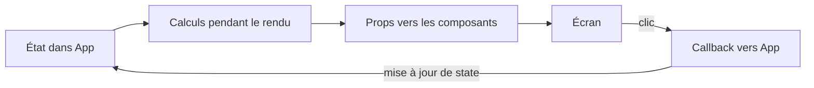

# Guide technique du mini-projet

Ce dossier explique le fonctionnement de l’application à partir de son code. Lisez les chapitres dans l’ordre : chacun ajoute une notion au modèle mental construit par le précédent.

| Chapitre | Question à laquelle il répond |
| --- | --- |
| [01 — Projet et architecture](01-projet-et-architecture.md) | Comment Vite lance-t-il React et où vivent les responsabilités ? |
| [02 — Composants, JSX et props](02-composants-jsx-props.md) | Comment une fonction devient-elle une interface réutilisable ? |
| [03 — Listes, clés et filtres](03-listes-cles-filtres.md) | Comment les quatre objets deviennent-ils des cartes filtrables ? |
| [04 — State, événements et immutabilité](04-state-evenements-immutabilite.md) | Que se passe-t-il réellement après un clic ? |
| [05 — Lifting state et données dérivées](05-lifting-state-donnees-derivees.md) | Pourquoi liste, compteur et détail restent-ils cohérents ? |
| [06 — Scénarios et diagnostic](06-scenarios-et-diagnostic.md) | Comment vérifier le comportement et localiser une erreur ? |

Le code complet est dans [`src/`](../src/). Le [README principal](../README.md) donne le démarrage rapide et [`LIVRABLE.md`](../LIVRABLE.md) contient la grille de réussite et l’arbre demandé.

## Contrat du projet

Trois valeurs sont conservées entre les rendus dans `App` : `departures`, `filter` et `selectedId`. Tout le reste (`visibleDepartures`, `selectedDeparture`, `selectedVisibleDeparture`, `selectionHidden` et le compteur) est recalculé à partir d’elles. Les données restent dans le navigateur ; aucun serveur métier ne reçoit les changements.

